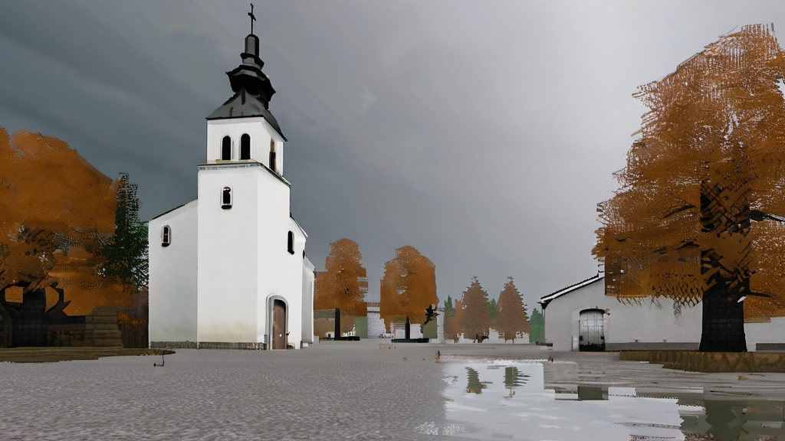
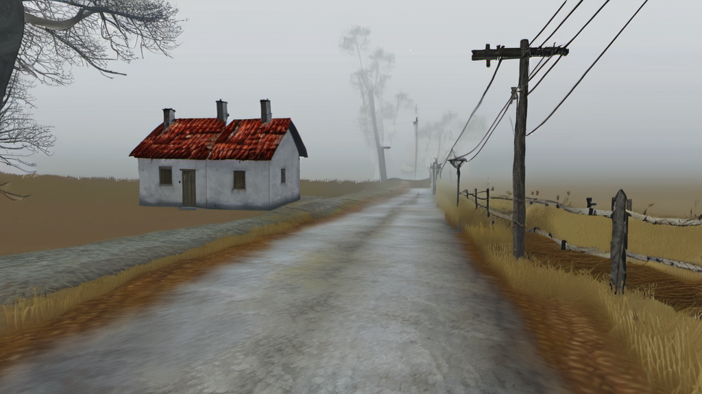
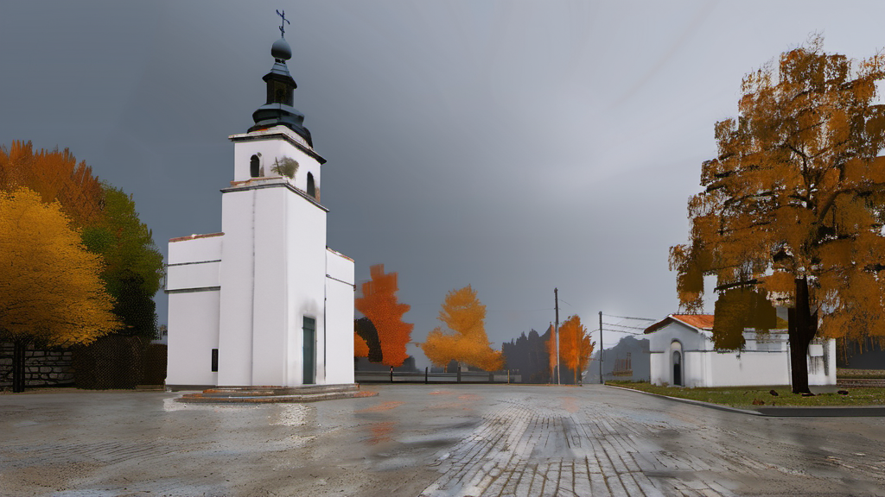

# Trauma Village

Survival horror robiony w Godocie 4.7. Kaszuby, dziś. Jedna wieś, jeden
dzień, jedna noc i jedna droga wyjścia.

Nie jesteś żołnierzem. Masz pistolet z 44 nabojami, strzelbę z 10 i wieś, która
po zmroku przestaje być znajoma. Te same trzy ulice, ten sam plac i ta sama
droga nad jeziorem wracają trzy razy: w dzień, o zmierzchu i w nocy. Geometria
się nie zmienia. Zmienia się światło, mgła, dźwięk i to, ile widzisz przed
sobą.

Amunicji nie wystarczy na wszystko. Czternaście spotkań z wrogiem, około
jedenastu zabójstw, resztę trzeba obejść. Sprint jest głośny, więc ostatnie
dwadzieścia minut gra się bez biegania.

## Co ma być w wersji 1

- jedna wieś, cztery wnętrza, dwa leśne korytarze
- trzy zagadki środowiskowe
- jeden typ wroga w trzech wariantach
- pistolet i strzelba, kamera zza ramienia
- dwa zakończenia, 90 do 120 minut
- teksty po polsku, tłumaczenie na angielski

## Status

Wczesna produkcja. Jest szkielet projektu, dokumentacja i zespół agentów.
Grywalnego builda jeszcze nie ma. Najbliższy cel to vertical slice "Pierwsza
ulica": jedna ulica, plac, jedno wnętrze i przejście z dnia w zmierzch.

Postęp widać w `docs/`, a nie w kodzie, bo najpierw ustalamy zakres i zasady,
dopiero potem piszemy systemy.

## Wzorzec miejsca: Linia

Wieś w grze jest fikcyjna, ale wygląd bierzemy z prawdziwej Lini w powiecie
wejherowskim: biały kościół z wieżą i zegarem, kostka na placu, kute płoty,
betonowe słupy z kablami, zarastająca linia kolejowa, mgła nad polami.
Wszystko renderowane w stylu PS2: mało poligonów, niskiej rozdzielczości
tekstury, płaskie światło, dithering i ząbki na krawędziach. To look-dev,
nie screenshoty z gry.


*Plac w dzień. Biały kościół, kostka, mokry listopad.*


*Droga o zmierzchu. Asfalt z łatami, słupy i czerwony dach.*


*Plac wieczorem. Światła ubywa, mgła wchodzi między domy.*

## Jak to powstaje

Mariusz ustala kierunek, ocenia grywalność i robi playtesty. Pucek (agent
opencode) prowadzi produkcję i uruchamia sześciu subagentów: `game-designer`,
`writer`, `artist`, `level-designer`, `programmer` i `animator`. Każdy pisze
tylko w swoim katalogu i kończy pracę raportem.

Grafika powstaje offline w lokalnym ComfyUI na SDXL, z wpisem w manifeście dla
każdego obrazu (model, seed, licencja, prompt). W grze nie ma żadnego modelu
językowego w runtime, build jest deterministyczny.

## Struktura

```
docs/     GDD, zakres, kryteria akceptacji, bestiariusz, art bible
story/    scenariusz i dialogi (Ink)
levels/   blockouty i przepływ poziomów
src/      kod gry
scenes/   sceny Godota
art/      graficzne assety finalne, surowe generacje poza repo
anim/     animacje i retarget
tests/    testy headless
tools/    generowanie grafiki, walidacja Ink
```

## Uruchomienie

Wymaga Godota 4.7 (flatpak) i Pythona 3.

```bash
flatpak run org.godotengine.Godot --path . --headless --quit-after 120
python3 tools/ink_check.py
```

## Dokumentacja

- `docs/GDD.md` - założenia gry, pętla rozgrywki, balans
- `docs/scope.md` - co wchodzi do wersji 1, a co nie
- `docs/acceptance.md` - mierzalne kryteria odbioru
- `docs/bestiary.md` - folklor i źródła
- `docs/art-bible.md` - paleta, styl, zasady assetów

Kod i nazwy po angielsku, treść gry po polsku.
